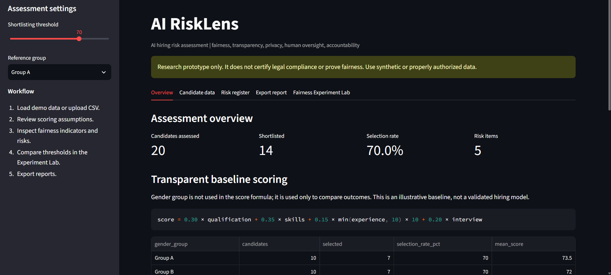
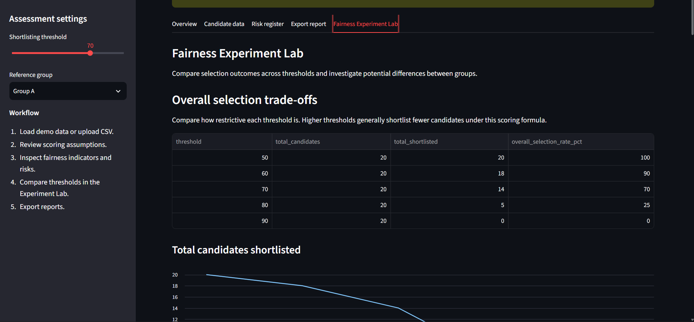
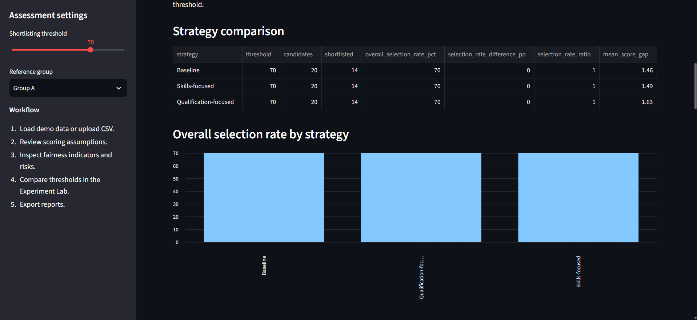

# AI RiskLens — AI Hiring Risk Assessment Toolkit

AI RiskLens is a Streamlit-based research prototype for evaluating potential governance and fairness risks in AI-assisted hiring. It calculates candidate scores using transparent rules, compares group-level outcomes, evaluates alternative scoring strategies, and generates structured risk assessment reports.

**Important:** This is an educational research prototype, not a production hiring system, legal compliance tool, or proof of fairness. Scoring weights are illustrative and must not be used to make real employment decisions.

## Features

- **Candidate data management:** Load synthetic candidate profiles or upload CSV files with schema validation.
- **Transparent scoring:** Calculate baseline scores using an inspectable weighted formula and configurable shortlisting threshold.
- **Fairness indicators:** Compare group selection rates, selection-rate ratios, percentage-point differences, and mean score gaps.
- **Fairness Experiment Lab:** Compare shortlisting thresholds of 50, 60, 70, 80, and 90.
- **Threshold trade-off analysis:** Examine selection volumes and group outcome differences across thresholds.
- **Scoring strategy experiments:** Compare baseline, skills-focused, and qualification-focused weighting strategies using the same dataset and threshold.
- **Risk register:** Document potential risks related to outcome disparities, scoring validity, explainability, privacy, human oversight, and auditability.
- **Report exports:** Download JSON assessment reports and CSV files containing candidate results, risk registers, and experiment outputs.
- **Automated testing:** Unit tests for data validation, scoring, thresholds, fairness metrics, risk generation, and report generation.

## Technology stack

- Python
- Streamlit
- pandas
- pytest
- CSV and JSON

## Run locally on Windows

Open PowerShell in the project directory:

```powershell
cd F:\AI-Safety-Portfolio\AI_RiskLens
```

Create the virtual environment if you have not already created it:

```powershell
py -m venv .venv
```

Install the dependencies:

```powershell
.\.venv\Scripts\python.exe -m pip install -r requirements.txt
```

Start the application:

```powershell
.\.venv\Scripts\python.exe -m streamlit run app.py
```

Open the local URL printed in the terminal, usually `http://localhost:8501`.

## Run automated tests

```powershell
.\.venv\Scripts\python.exe -m pytest -q
```

The current test suite has **5 passing tests**. This verifies the covered application logic, not the correctness of every possible fairness assessment or the safety of a real hiring system.

## Candidate CSV format

The uploaded dataset must contain these columns:

| Column | Description |
|---|---|
| `candidate_id` | Unique candidate record identifier |
| `gender_group` | Illustrative group label for outcome comparisons |
| `qualification_score` | Qualification score from 0 to 100 |
| `skills_score` | Skills score from 0 to 100 |
| `experience_years` | Non-negative years of experience |
| `interview_score` | Interview score from 0 to 100 |

Use synthetic or properly authorized data. Avoid uploading identifiable or sensitive candidate information.

## Baseline scoring methodology

The baseline score is calculated as:

```text
score = 0.30 × qualification_score
      + 0.35 × skills_score
      + 0.15 × min(experience_years, 10) × 10
      + 0.20 × interview_score
```

Candidates are marked `SHORTLIST` when their score meets or exceeds the selected threshold.

The group label is not included in the scoring formula. It is used for group-level outcome comparisons. Excluding a group label from the formula does not, by itself, guarantee fair outcomes.

## Experiments

### 1. Threshold comparison

The experiment lab compares selection outcomes across five thresholds while keeping the candidate data and baseline scoring formula unchanged. It reports group selection rates, disparity measures, and the total number shortlisted.

### 2. Scoring strategy comparison

Three illustrative strategies are compared:

- **Baseline:** 30% qualifications, 35% skills, 15% experience, 20% interview.
- **Skills-focused:** 20% qualifications, 50% skills, 10% experience, 20% interview.
- **Qualification-focused:** 50% qualifications, 25% skills, 10% experience, 15% interview.

All strategies use the same dataset and the current threshold. These alternative weights are experimental hypotheses, not validated hiring criteria.

## Interpreting results

- **Selection-rate difference:** Absolute percentage-point difference between the reference group and the lowest-selection-rate non-reference group.
- **Selection-rate ratio:** Compared group's selection rate divided by the reference group's selection rate, where defined.
- **Mean score gap:** Absolute difference between the compared groups' mean baseline scores.
- **Selection volume:** Number of candidates meeting the selected threshold.

A selection-rate ratio below 0.80 is used as a screening heuristic in this prototype, not as a legal determination. Equal selection rates do not establish fairness, and a smaller measured disparity does not necessarily mean a better outcome.

Small samples, data quality, job relevance, measurement choices, and contextual factors affect interpretation. The current experiments use synthetic data and do not establish causal discrimination or real-world model performance.

## Governance limitations

The prototype does not implement production authentication, authorization, encryption-at-rest, enforced data-retention controls, operational recruiter approval, or an appeals process. Some safeguards are documented as recommendations rather than implemented features.

The tool does not certify compliance with any law or regulation and is not a substitute for a formal impact assessment or qualified legal advice.

## Future research directions

Potential extensions include:

1. Add confidence intervals and minimum sample-size warnings.
2. Evaluate additional fairness metrics and subgroup comparisons where appropriate.
3. Validate scoring criteria against job-related evidence.
4. Document a model card and dataset statement.
5. Map the assessment methodology to a published AI risk-management framework.
6. Add reproducible experiment tracking and reviewer sign-off.
7. Evaluate whether mitigation strategies create trade-offs in selection outcomes.

## Project structure

```text
AI_RiskLens/
├── app.py
├── risklens.py
├── requirements.txt
├── README.md
├── sample_candidates.csv
└── tests/
    └── test_risklens.py
```
## Application Screenshots

### Dashboard


### Fairness Experiment Lab


### Scoring Strategy Comparison
